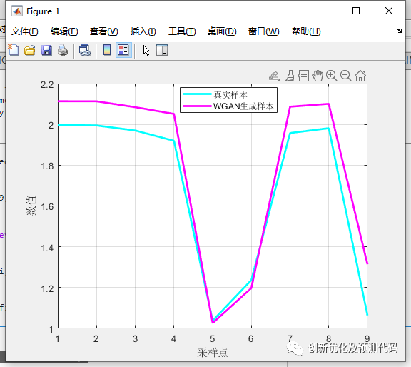

# Wasserstein-GAN(WGAN) adversarial generative network, data imported from Excel, directly

Applicable Platforms: Matlab 2021a and above
Wasserstein Generative Adversarial Network (WGAN) is an improved version of the Generative Adversarial Network (GAN) that aims to address issues present in traditional GAN models such as gradient vanishing, training instability, and mode collapse. WGAN introduces Wasserstein distance (also known as Earth Mover's Distance, EMD) as the optimization objective for GANs, facilitating more stable and interpretable training of generators and discriminators.
Here are some key features and working principles of Wasserstein GAN:
Wasserstein Distance: The traditional GAN uses Jensen-Shannon divergence or Kullback-Leibler divergence as the loss function, but these loss functions have issues leading to unstable training. WGAN introduces Wasserstein distance, which is considered a better metric for measuring the difference between two distributions, especially effective for high-dimensional data. Wasserstein distance calculates the minimum cost to transform one distribution into another, often referred to as "transportation" cost.
Gradient Stability: WGAN significantly improves gradient stability by using Wasserstein distance as the loss function. This means that during training, the gradients between the generator and discriminator do not suddenly vanish or explode, making it easier to converge to a stable solution.
Lipschitz Continuity: To ensure that the discriminator is Lipschitz continuous (an important mathematical property for calculating Wasserstein distance), WGAN applies weight clipping or weight constraints on the discriminator weights to prevent gradient instability. This step is known as weight clipping.
Generator and Discriminator Balance: The training process of WGAN is easier to achieve a balance between the generator and discriminator. This means that the performance difference between the generator and discriminator will not be too large, making the generator more likely to generate high-quality samples.
High-Quality Sample Generation: Due to the stability and balance of WGAN, the generator is more likely to generate high-quality data samples, which is very useful for tasks such as image generation and data generation.
In summary, Wasserstein GAN addresses some issues in traditional GAN models by introducing Wasserstein distance and a series of improvements, making it easier to train generative adversarial networks and generating higher quality data. This makes WGAN an important advancement in the field of generative models.
Adversarial Generative Samples Comparison:
Partial code:
​\n%xxxxx\n%% Training\niterationG = 0;\niterationD = 0;\nstart = tic;\n​\n%% Loop processing like batch data\nwhile iterationG < numIterationsG\n    % Generator iteration count + 1\n    iterationG = iterationG + 1;\n​\n    % Train the discriminator\n    for n = 1 : numIterationsDPerG\n        iterationD = iterationD + 1;\n​\n        % Reset and shuffle the data\n        temp = randperm(size(augimds, 4));\n        data = augimds(:, : , :, temp);\n​\n        % Read batch data\n        X = single(data);\n        % Data type conversion\n        [X, ps_output] = mapminmax(X, -1, 1);\n        dlX = dlarray(X, 'SSCB');\n​\n        % Generate generator input samples and convert format\n        Z = randn([numLatentInputs, size(dlX, 4)], 'like', dlX);\n        dlZ = dlarray(Z, 'CB');\n​\n        % Obtain the discriminator loss and gradients\n        [gradientsD, lossD, lossDUnregularized] = dlfeval(@modelGradientsD, dlnetD, dlnetG, dlX, dlZ, lambda);\n​\n        % Update the discriminator parameters\n        [dlnetD, trailingAvgD, trailingAvgSqD] = adamupdate(dlnetD, gradientsD, ...\n            trailingAvgD, trailingAvgSqD, iterationD, ...\n            learnRateD, gradientDecayFactor, squaredGradientDecayFactor);\n    end\n​\n    % Obtain the generator input samples and convert them.\n    Z = randn([numLatentInputs, size(dlX, 4)], 'like', dlX);\n    dlZ = dlarray(Z, 'CB');\n​\n    % Obtain generator gradients\n    gradientsG = dlfeval(@modelGradientsG, dlnetG, dlnetD, dlZ);\n​\n    % Update the discriminator parameters\n    [dlnetG, trailingAvgG, trailingAvgSqG] = adamupdate(dlnetG, gradientsG, ...\n        trailingAvgG, trailingAvgSqG, iterationG, ...\n        learnRateG, gradientDecayFactor, squaredGradientDecayFactor);\n​\n   %% Update display curve\n    subplot(1, 1, 1)\n    % Obtain the discriminator loss function and the unpenalized loss function\n    lossD = double(gather(extractdata(lossD)));\n    lossDUnregularized = double(gather(extractdata(lossDUnregularized)));\n    \n    % Update the curve\n    addpoints(lineLossD, iterationG, lossD);\n    addpoints(lineLossDUnregularized, iterationG, lossDUnregularized);\n    \n    % Update the title\n    D = duration(0, 0, toc(start), 'Format', 'hh:mm:ss');\n    title( ...\n        "Iteration: " + iterationG + ", " + ...\n        "Elapsed: " + string(D))\n    drawnow\nend\n​\n%% Generate generator input data\nZNew = randn(numLatentInputs, M, 'single');\ndlZNew = dlarray(ZNew, 'CB');\n​\n%% Check if there is a GPU\nif (executionEnvironment == "auto" && canUseGPU) || executionEnvironment == "gpu"\n    dlZNew = gpuArray(dlZNew);\nend\n​\n%% Generate data\ndlXGeneratedNew = predict(dlnetG, dlZNew);\n  

## Images

<!-- PAYMENT_BLOCK -->

## Get this dataset

- Payment link (Stripe): [Buy now](https://buy.stripe.com/3cs8yP7sY87d0vu9AB)
- Payment QR code: 

<!-- /PAYMENT_BLOCK -->
